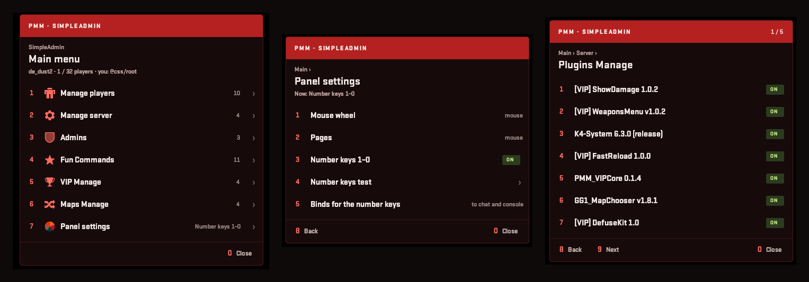

# PMM_SimpleAdmin

<h2><a href="https://genesis-cs.space/menuconstructor/index.html">>>>Более подробная информация на сайте<<<</a></h2>



[English](#english) · [Русский](#русский)

## English

Admin panel by **Rimmer** for [CS2-SimpleAdmin](https://github.com/daffyyyy/CS2-SimpleAdmin) (daffyyyy, 1.9.x) on top of
[PanoramaMenuManager](https://github.com/RRimmer/PanoramaMenuManagerCS2) (MenuManagerCS2 1.2.05). SimpleAdmin is not changed:
its menus are tagged with Harmony when SimpleAdmin creates them, PMM hands them to this module (`pmm:paint`) and every click
calls SimpleAdmin's own callbacks.

Current version: **0.1.1**. Needs CounterStrikeSharp 1.0.378 (.NET 10), CS2-SimpleAdmin 1.9.x and MenuManager 1.2.04+ (1.2.05 for the number keys).

- Red "Classic+" panel: menu path ("Main › Players ›"), section icons, menu counts on the right of the main menu,
  "map · players / slots" line, team colour and `#userid` on player rows, "›" on entries with a submenu, dangerous actions in red,
  plugin manager entries as ON / OFF pills.
- The panel always opens for SimpleAdmin menus (`ForcePanorama`), whatever the admin picked in `!menu` and whatever
  SimpleAdmin's `MenuType` is. SimpleAdmin modules (FunCommands and others) are drawn on the same panel.
- "Panel settings" per admin: mouse wheel (default), pages, or number keys 1–0 (1–7 pick, 8 back, 9 next, 0 close)
  with a mandatory key test (progress bar, pressed and missing keys). The choice is stored in SimpleAdmin's database:
  MySQL table `pmm_sa_players`, or an own `pmm_simpleadmin.sqlite` when SimpleAdmin uses SQLite.
- Sections of other plugins appear by themselves when the plugin is on the server (all config blocks exist from the first start):
  - **VIP Manage** — [cs2-VIPCore](https://github.com/partiusfabaa/cs2-VIPCore) 1.x / 2.x: give / change VIP (group → term), remove VIP, VIP online, reload config.
  - **Maps Manage** — [GG1MapChooser](https://github.com/ssypchenko/GG1MapChooser): change map (+ random), next map, votes, map pools.
    `!maps` and SimpleAdmin's "Manage server → Change map" lead here.
  - **Store Manage** — [cs2-store](https://github.com/schwarper/cs2-store): give / take credits, give items.
- Panel texts, renames and grey hints are edited in MenuManager's `MenuManager_Modules_Translation.json` (section `PMM_SimpleAdmin`, per player language).

### Repository layout

| Folder | What it is |
| --- | --- |
| `PMM_SimpleAdmin` | The plugin: `Plugin.cs` (Harmony, commands), `Panel.cs` (panel painter), `Settings.cs` (menu styles, number keys test), `Storage.cs` (MySQL / SQLite), `Integrations.cs` (VIP / Maps / Store sections), `Translations.cs`, `Config.cs` |
| `PMM_SimpleAdmin/panorama` | Client files for the MultiAddonManager addon: `pmm_admin.xml`, `pmm_admin.css` |
| `PMM_SimpleAdmin/lib` | `0Harmony.dll` (Lib.Harmony 2.4.2, net10.0) |
| `PMM_SimpleAdmin/native` | `linux-x64/libe_sqlite3.so` — SQLite built for GLIBC 2.28 (same file as in PMM core) |
| `tools` | `gen_layout.py` — generates the panorama files (`python3 tools/gen_layout.py PMM_SimpleAdmin`) |
| `MenuManagerApi` | Compile-time library. Do not copy `MenuManagerApi.dll` next to this plugin |
| `configs` | Example config |

No CS2-SimpleAdmin, VIPCore, GG1MapChooser or cs2-store dll is needed for the build: their APIs are used by reflection.

### Install from a Release

Copy `Server-plugins/counterstrikesharp` into `game/csgo/addons/`. You get:

- `plugins/PMM_SimpleAdmin/PMM_SimpleAdmin.dll` with `MySqlConnector.dll`, `Microsoft.Data.Sqlite.dll`, `SQLitePCLRaw.*.dll` and `runtimes/`
- `plugins/PMM_SimpleAdmin/harmony/0Harmony.dll`
- `configs/plugins/PMM_SimpleAdmin/PMM_SimpleAdmin.json`

`0Harmony.dll` stays only in `harmony/`. `MenuManagerApi.dll` stays only in `shared/`.
Restart the server after an install or update: `css_plugins reload` does not unload Harmony.

Copy `Content-addonmanager/panorama` into the MultiAddonManager addon and rebuild it.

Server console: `css_pmm_sa` (status), `css_pmm_sa reattach`, `css_pmm_sa debug`, `css_pmm_sa integrations`.

Full guide: [INSTALL.md](INSTALL.md).

### Build

You need the .NET 10 SDK.

```bash
dotnet build PMM_SimpleAdmin.sln --configuration Release
```

Output: `PMM_SimpleAdmin/bin/Release/net10.0/`. Ship `PMM_SimpleAdmin.dll`, the database dlls, `runtimes/` (linux-x64, linux-musl-x64, win-x64)
and `harmony/0Harmony.dll`. Do not ship `CounterStrikeSharp.API.dll` or `MenuManagerApi.dll`.

The changelog is in [CHANGELOG.md](CHANGELOG.md).

### License

[GNU GPL v3](LICENSE).

---

## Русский

Админ-панель от **Rimmer** для [CS2-SimpleAdmin](https://github.com/daffyyyy/CS2-SimpleAdmin) (daffyyyy, 1.9.x) поверх
[PanoramaMenuManager](https://github.com/RRimmer/PanoramaMenuManagerCS2) (MenuManagerCS2 1.2.05). SimpleAdmin не меняется:
его меню помечаются через Harmony в момент создания, PMM передаёт их этому модулю (`pmm:paint`), а каждый клик вызывает
обработчики самого SimpleAdmin.

Текущая версия: **0.1.1**. Нужен CounterStrikeSharp 1.0.378 (.NET 10), CS2-SimpleAdmin 1.9.x и MenuManager 1.2.04+ (для цифр — 1.2.05).

- Красная панель «Классика+»: путь по меню («Главное › Игроки ›»), значки разделов, числа справа у разделов главного меню,
  строка «карта · игроки / слоты», цвет команды и `#userid` у игроков, «›» у пунктов с подменю, опасные действия красным,
  плагины — плашки ВКЛ / ВЫКЛ.
- Панель открывается для меню SimpleAdmin всегда (`ForcePanorama`) — неважно, что админ выбрал в `!menu` и какой `MenuType`
  в SimpleAdmin. Модули SimpleAdmin (FunCommands и др.) рисуются на той же панели.
- «Настройки панели» у каждого админа свои: колёсико мыши (по умолчанию), страницы или цифры 1–0 (1–7 выбор, 8 назад, 9 далее,
  0 закрыть) с обязательной проверкой клавиш (полоса прогресса, нажатые и оставшиеся цифры). Выбор хранится в базе SimpleAdmin:
  таблица `pmm_sa_players` в MySQL или свой `pmm_simpleadmin.sqlite`, если SimpleAdmin на SQLite.
- Разделы других плагинов появляются сами, если плагин стоит на сервере (все блоки конфига есть с первого запуска):
  - **Управление VIP** — [cs2-VIPCore](https://github.com/partiusfabaa/cs2-VIPCore) 1.x / 2.x: выдать / изменить VIP (группа → срок), снять VIP, VIP онлайн, перезагрузка конфига.
  - **Управление картами** — [GG1MapChooser](https://github.com/ssypchenko/GG1MapChooser): сменить карту (+ случайная), следующая карта, голосования, пулы карт.
    `!maps` и «Управление сервером → Сменить карту» SimpleAdmin ведут сюда.
  - **Управление магазином** — [cs2-store](https://github.com/schwarper/cs2-store): выдать / забрать кредиты, выдать предмет.
- Тексты панели, переименования и серые подсказки правятся в `MenuManager_Modules_Translation.json` MenuManager (раздел `PMM_SimpleAdmin`, по языку игрока).

### Что лежит в репозитории

| Папка | Зачем |
| --- | --- |
| `PMM_SimpleAdmin` | Плагин: `Plugin.cs` (Harmony, команды), `Panel.cs` (отрисовка панели), `Settings.cs` (стили меню, проверка цифр), `Storage.cs` (MySQL / SQLite), `Integrations.cs` (разделы VIP / Карты / Магазин), `Translations.cs`, `Config.cs` |
| `PMM_SimpleAdmin/panorama` | Клиентские файлы для аддона MultiAddonManager: `pmm_admin.xml`, `pmm_admin.css` |
| `PMM_SimpleAdmin/lib` | `0Harmony.dll` (Lib.Harmony 2.4.2, net10.0) |
| `PMM_SimpleAdmin/native` | `linux-x64/libe_sqlite3.so` — SQLite под GLIBC 2.28 (тот же файл, что в ядре PMM) |
| `tools` | `gen_layout.py` — генерирует файлы панорамы (`python3 tools/gen_layout.py PMM_SimpleAdmin`) |
| `MenuManagerApi` | Библиотека только для сборки. `MenuManagerApi.dll` рядом с этим плагином не клади |
| `configs` | Пример конфига |

Для сборки не нужны dll CS2-SimpleAdmin, VIPCore, GG1MapChooser и cs2-store: их API вызываются через reflection.

### Установка с Release

`Server-plugins/counterstrikesharp` копируется в `game/csgo/addons/`. Получится:

- `plugins/PMM_SimpleAdmin/PMM_SimpleAdmin.dll` вместе с `MySqlConnector.dll`, `Microsoft.Data.Sqlite.dll`, `SQLitePCLRaw.*.dll` и `runtimes/`
- `plugins/PMM_SimpleAdmin/harmony/0Harmony.dll`
- `configs/plugins/PMM_SimpleAdmin/PMM_SimpleAdmin.json`

`0Harmony.dll` лежит только в `harmony/`. `MenuManagerApi.dll` — только в `shared/`.
После установки или обновления полностью перезапусти сервер: `css_plugins reload` не выгружает Harmony.

`Content-addonmanager/panorama` копируется в аддон MultiAddonManager, аддон пересобирается.

Консоль сервера: `css_pmm_sa` (статус), `css_pmm_sa reattach`, `css_pmm_sa debug`, `css_pmm_sa integrations`.

Подробная инструкция: [INSTALL.md](INSTALL.md).

### Сборка

Нужен .NET 10 SDK.

```bash
dotnet build PMM_SimpleAdmin.sln --configuration Release
```

Результат: `PMM_SimpleAdmin/bin/Release/net10.0/`. В поставку входят `PMM_SimpleAdmin.dll`, dll базы данных, `runtimes/` (linux-x64, linux-musl-x64, win-x64)
и `harmony/0Harmony.dll`. `CounterStrikeSharp.API.dll` и `MenuManagerApi.dll` не клади.

История изменений — в [CHANGELOG.md](CHANGELOG.md).

### Лицензия

[GNU GPL v3](LICENSE).
